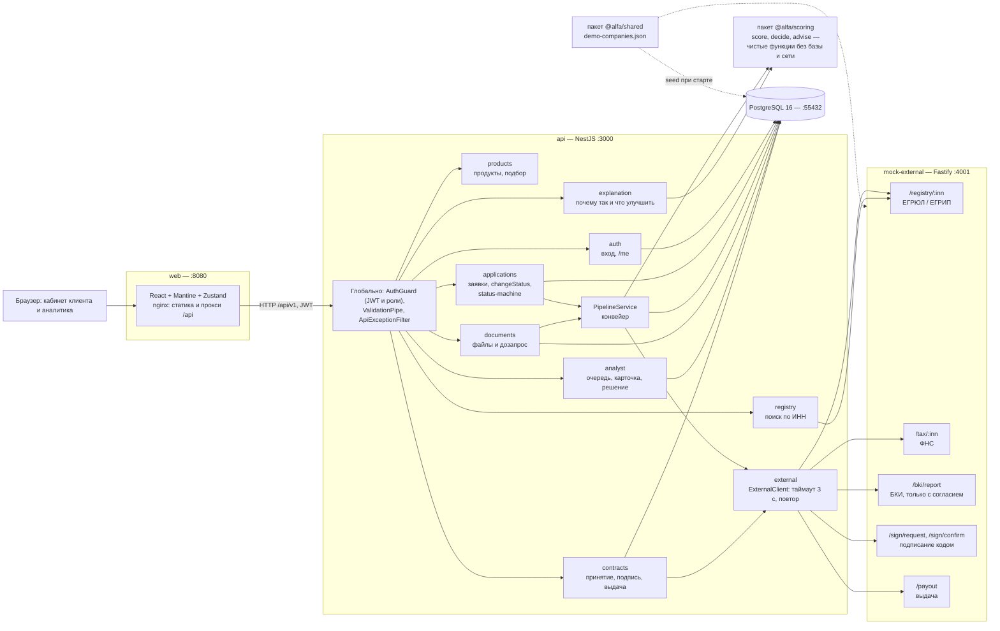
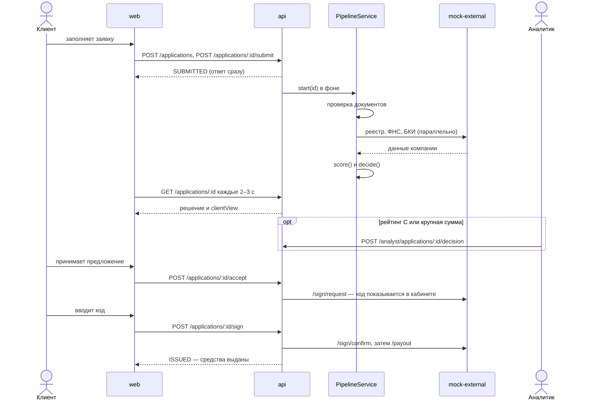

# Архитектура

Монорепозиторий на pnpm workspaces. Всё поднимается через Docker Compose: фронтенд, API, база и сервис-заглушка внешних систем.

## Компоненты

| Компонент | Что делает |
|---|---|
| **web** | одностраничное приложение на React + Mantine, состояние в Zustand, запросы через `fetch`. В Docker собирается и отдаётся nginx, который проксирует `/api` в API |
| **api** | NestJS. Все пути с префиксом `/api/v1`. Глобально: `AuthGuard` проверяет JWT и роли (`@Public`, `@Roles`), `ValidationPipe` проверяет тела запросов по DTO, `ApiExceptionFilter` приводит любые ошибки к формату `{ code, message, details }` |
| **auth** | вход по email и паролю (bcrypt), выдача JWT, `GET /me` — пользователь и его компании |
| **products** | список продуктов и подбор продукта по цели, сумме и сроку |
| **registry** | поиск компании по ИНН в реестре (через заглушку) |
| **applications** | создание, отправка, отзыв и просмотр заявок. `changeStatus` — единственное место смены статуса: проверка по таблице переходов (`status-machine.ts`), защита от одновременных изменений по `version`, запись в историю — в одной транзакции |
| **PipelineService** | конвейер: проверка документов → запросы в реестр, ФНС и БКИ → скоринг → решение. Работает в фоне, смотрит на текущий статус и делает следующий шаг, поэтому после перезапуска сервера продолжает заявки с того же этапа |
| **documents** | загрузка документов, чек-лист «чего не хватает», дозапрос. Когда клиент загрузил всё запрошенное, заявка сама возвращается в конвейер |
| **explanation** | объяснение решения клиенту: сильные и слабые стороны, подсказки «что сделать, чтобы условия стали лучше» |
| **analyst** | очередь заявок на ручное рассмотрение, карточка со всеми данными, решение с обязательным комментарием, запрос документа |
| **contracts** | принятие предложения → договор → подпись кодом → выдача денег |
| **external** | `ExternalClient` — общий клиент внешних сервисов: таймаут 3 секунды и одна повторная попытка при сбое. Ошибки не бросает — конвейер сам решает, что делать (например, передать заявку специалисту) |
| **@alfa/scoring** | пакет с чистыми функциями: `score` (баллы, рейтинг, стоп-факторы), `decide` (решение, ставка, контрпредложение), `advise` (подсказки клиенту). Без базы и сети, покрыт тестами |
| **@alfa/shared** | синтетические данные 7 демо-компаний: из них заполняется база при старте и отвечает заглушка |
| **mock-external** | Fastify-сервис, который заменяет внешние системы банка: реестр, ФНС, БКИ, подписание и выдачу |
| **PostgreSQL** | все данные; миграции применяются автоматически при старте API |

## Как проходит заявка

## Порты при запуске через Docker Compose

| Сервис | Адрес |
|---|---|
| Кабинет (web) | http://localhost:8080 |
| API | http://localhost:3000/api/v1 |
| Заглушка внешних систем | http://localhost:4001 |
| PostgreSQL | localhost:55432 |
