# Модель данных

Источник правды — [`apps/api/src/db/schema.ts`](../apps/api/src/db/schema.ts) (Drizzle ORM), миграции — в [`apps/api/drizzle`](../apps/api/drizzle). База — PostgreSQL 16, 13 таблиц.

```mermaid
erDiagram
    users ||--o{ company_members : "состоит в"
    companies ||--o{ company_members : "сотрудники"
    companies ||--o| company_financials : "финансы"
    companies ||--o{ applications : "заявки компании"
    users ||--o{ applications : "подаёт"
    products ||--o{ applications : "продукт"
    applications ||--o{ application_status_history : "история статусов"
    applications ||--o{ external_checks : "ответы внешних сервисов"
    applications ||--o{ scoring_results : "скоринг"
    applications ||--o{ decisions : "решения"
    applications ||--o| contracts : "договор"
    applications ||--o{ documents : "документы"
    users ||--o{ documents : "загружает"
    applications ||--o{ info_requests : "запросы документов"

    users {
        uuid id PK
        text email UK
        text password_hash "bcrypt"
        text full_name
        role role "CLIENT или ANALYST"
        timestamptz created_at
    }
    companies {
        uuid id PK
        text inn UK
        text ogrn
        company_type type "LLC или IE"
        text name
        company_status status "ACTIVE, LIQUIDATING, LIQUIDATED, BANKRUPT"
        date registered_at
        text okved
        text okved_name
        text address
        text director_name
        timestamptz created_at
    }
    company_members {
        uuid user_id PK, FK
        uuid company_id PK, FK
        member_position position "OWNER, CEO, CFO, ACCOUNTANT, OTHER"
    }
    company_financials {
        uuid company_id PK, FK
        bigint avg_monthly_revenue "копейки"
        bigint revenue_last_6m "копейки"
        bigint revenue_prev_6m "копейки"
        bigint existing_monthly_payments "копейки"
        timestamptz updated_at
    }
    products {
        uuid id PK
        product_code code UK "OVERDRAFT, WORKING_CAPITAL, EQUIPMENT"
        text name
        bigint min_amount "копейки"
        bigint max_amount "копейки"
        int min_term "месяцы"
        int max_term "месяцы"
        double base_rate "% годовых"
        double revenue_multiplier
        int min_business_age_months
        bigint auto_decision_limit "копейки"
        boolean annuity
        jsonb required_docs "тип документа и сумма, с которой он нужен"
    }
    applications {
        uuid id PK
        serial seq "номер ЗК-2026-000042"
        uuid company_id FK
        uuid applicant_id FK
        uuid product_id FK
        purpose purpose "CASH_GAP, WORKING_CAPITAL, EQUIPMENT, OTHER"
        bigint requested_amount "копейки"
        int requested_term "месяцы"
        application_status status "14 статусов"
        timestamptz bki_consent_at
        timestamptz submitted_at
        int version "защита от одновременных изменений"
        timestamptz created_at
        timestamptz updated_at
    }
    application_status_history {
        uuid id PK
        uuid application_id FK
        application_status from_status
        application_status to_status
        actor_type actor_type "CLIENT, ANALYST, SYSTEM"
        uuid actor_id
        text reason
        timestamptz created_at
    }
    external_checks {
        uuid id PK
        uuid application_id FK
        check_source source "REGISTRY, TAX, BKI"
        boolean ok
        int http_status
        int duration_ms
        jsonb payload "ответ сервиса или ошибка"
        timestamptz created_at
    }
    scoring_results {
        uuid id PK
        uuid application_id FK
        int score "0-1000"
        text grade "A, B, C, D"
        jsonb factors "баллы и пояснения"
        jsonb stop_factors
        jsonb input "входные данные скоринга"
        text rules_version
        timestamptz created_at
    }
    decisions {
        uuid id PK
        uuid application_id FK
        decision_type type "APPROVE, COUNTER_OFFER, MANUAL_REVIEW, REJECT"
        double rate
        bigint max_available_amount "копейки"
        jsonb offer
        jsonb alternatives
        jsonb reasons
        actor_type actor_type "SYSTEM или ANALYST"
        uuid actor_id
        timestamptz created_at
    }
    contracts {
        uuid id PK
        uuid application_id FK, UK
        text number UK "ДГ-2026-000042"
        jsonb offer "принятые условия"
        text sign_request_id
        text demo_sign_code "код показывается в кабинете"
        timestamptz signed_at
        text payout_id
        timestamptz issued_at
        timestamptz created_at
    }
    documents {
        uuid id PK
        uuid application_id FK
        doc_type doc_type "FINANCIAL_STATEMENTS, EQUIPMENT_INVOICE, OTHER"
        text file_name
        text mime_type
        int size_bytes
        bytea content "сам файл"
        uuid uploaded_by FK
        timestamptz created_at
    }
    info_requests {
        uuid id PK
        uuid application_id FK
        doc_type doc_type
        text comment
        actor_type actor_type "SYSTEM или ANALYST"
        uuid actor_id
        timestamptz fulfilled_at "закрыт, когда документ загружен"
        timestamptz created_at
    }
```

## Таблицы

| Таблица | Что хранит |
|---|---|
| `users` | клиенты и аналитики, пароль только в виде bcrypt-хэша |
| `companies` | компании и ИП, данные как в реестре |
| `company_members` | кто от какой компании может подавать заявки (у бухгалтера может быть несколько компаний) |
| `company_financials` | выручка и текущие платежи по кредитам компании, одна строка на компанию |
| `products` | кредитные продукты: лимиты, сроки, ставки, обязательные документы |
| `applications` | заявки: что просят, текущий статус, согласие на запрос в БКИ |
| `application_status_history` | журнал всех смен статуса — только добавление, без изменений |
| `external_checks` | что ответили реестр, ФНС и БКИ и сколько длился запрос |
| `scoring_results` | баллы, рейтинг, факторы и входные данные скоринга, версия правил |
| `decisions` | решения системы и аналитика; действующее — последнее по времени |
| `contracts` | договор: принятые условия, подпись, выдача; не больше одного на заявку |
| `documents` | загруженные клиентом файлы |
| `info_requests` | запросы документов от системы или аналитика |

## Почему так

- **Деньги — `bigint` в копейках.** Целые числа, без ошибок округления дробей.
- **`version` в заявке** — защита от одновременных изменений: смена статуса проходит, только если с момента чтения заявку никто не изменил, иначе `409 CONCURRENT_UPDATE`.
- **История статусов только дописывается.** По ней видно, кто и почему менял заявку, — это аудит.
- **Факторы скоринга, предложения и причины — в `jsonb`.** У них вложенная структура, а читаются они всегда целиком вместе с заявкой.
- **Входные данные скоринга и версия правил сохраняются.** Решение можно воспроизвести и объяснить.
- **Файлы документов хранятся в `bytea`.** Для прототипа так проще: не нужен отдельный том в Docker. В промышленной версии файл лежал бы в объектном хранилище, а в базе — ссылка.
- **Перечисления (`role`, `application_status`, `doc_type` и другие) — типы ENUM в PostgreSQL.** База не даст записать недопустимое значение.
