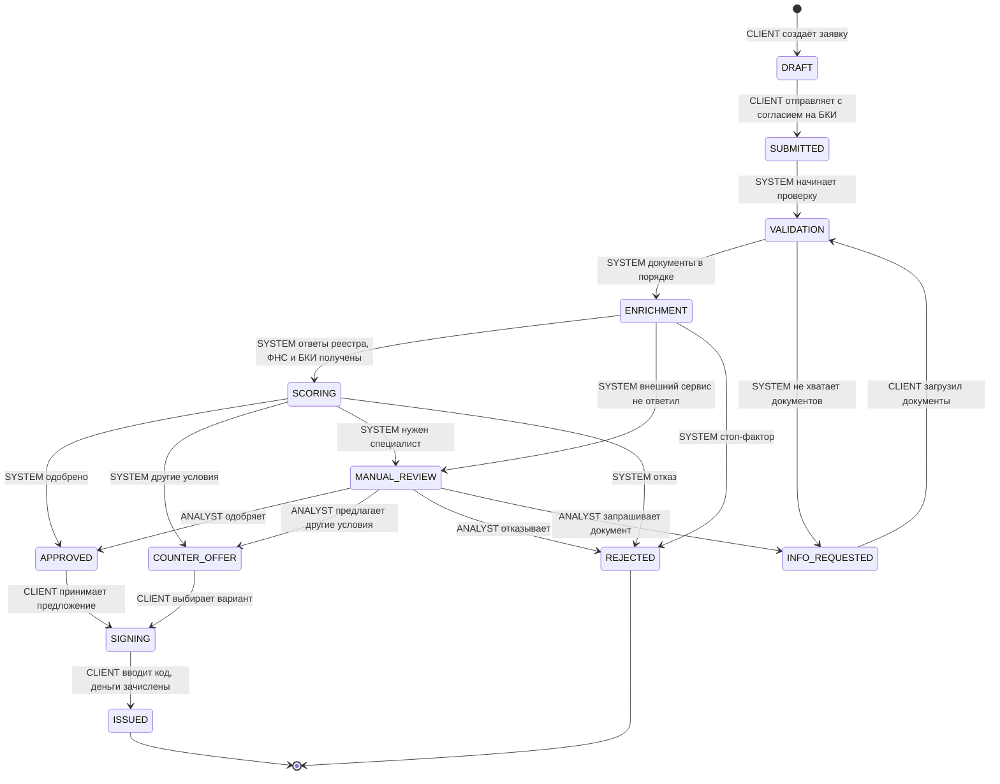

# Машина состояний заявки

Источник правды — таблица `TRANSITIONS` в [`apps/api/src/applications/status-machine.ts`](../apps/api/src/applications/status-machine.ts). Любой переход, которого нет в таблице, API отклоняет с ошибкой `409 INVALID_TRANSITION`. Каждый переход записывается в `application_status_history`: откуда, куда, кто и почему.

Кто может выполнить переход:
- **CLIENT** — клиент в своём кабинете;
- **SYSTEM** — конвейер (проверка документов, запросы во внешние сервисы, скоринг);
- **ANALYST** — аналитик банка.

На схеме — основной путь. Чтобы она читалась, на ней нет двух групп переходов (они есть в таблице ниже):
- **отзыв клиентом → `CANCELLED`** — из любого незавершённого статуса до подписания: `DRAFT`, `SUBMITTED`, `VALIDATION`, `INFO_REQUESTED`, `ENRICHMENT`, `SCORING`, `MANUAL_REVIEW`, `APPROVED`, `COUNTER_OFFER`;
- **истечение срока → `EXPIRED`** — из `INFO_REQUESTED`, `APPROVED`, `COUNTER_OFFER`.

## Все переходы

| Из статуса | В статус | Кто | Когда |
|---|---|---|---|
| DRAFT | SUBMITTED | CLIENT | клиент отправил заявку с согласием на запрос в БКИ |
| DRAFT | CANCELLED | CLIENT | клиент отозвал черновик |
| SUBMITTED | VALIDATION | SYSTEM | конвейер взял заявку в работу |
| SUBMITTED | CANCELLED | CLIENT | клиент отозвал заявку |
| VALIDATION | ENRICHMENT | SYSTEM | все обязательные документы есть |
| VALIDATION | INFO_REQUESTED | SYSTEM | не хватает обязательного документа для продукта |
| VALIDATION | CANCELLED | CLIENT | клиент отозвал заявку |
| INFO_REQUESTED | VALIDATION | CLIENT, SYSTEM | клиент загрузил всё запрошенное — конвейер продолжает сам |
| INFO_REQUESTED | CANCELLED | CLIENT | клиент отозвал заявку |
| INFO_REQUESTED | EXPIRED | SYSTEM | документы не загружены вовремя |
| ENRICHMENT | SCORING | SYSTEM | получены ответы реестра, ФНС и БКИ |
| ENRICHMENT | REJECTED | SYSTEM | стоп-фактор из внешних данных |
| ENRICHMENT | MANUAL_REVIEW | SYSTEM | внешний сервис не ответил — решает специалист |
| ENRICHMENT | CANCELLED | CLIENT | клиент отозвал заявку |
| SCORING | APPROVED | SYSTEM | авто-одобрение |
| SCORING | COUNTER_OFFER | SYSTEM | запрошенную сумму дать нельзя, есть другие варианты |
| SCORING | MANUAL_REVIEW | SYSTEM | рейтинг C или сумма выше лимита авто-решения |
| SCORING | REJECTED | SYSTEM | стоп-фактор или рейтинг D |
| SCORING | CANCELLED | CLIENT | клиент отозвал заявку |
| MANUAL_REVIEW | APPROVED | ANALYST | аналитик одобрил (с комментарием) |
| MANUAL_REVIEW | COUNTER_OFFER | ANALYST | аналитик предложил другие сумму или срок |
| MANUAL_REVIEW | REJECTED | ANALYST | аналитик отказал, комментарий видит клиент |
| MANUAL_REVIEW | INFO_REQUESTED | ANALYST | аналитик запросил документ |
| MANUAL_REVIEW | CANCELLED | CLIENT | клиент отозвал заявку |
| APPROVED | SIGNING | CLIENT | клиент принял предложение — создан договор |
| APPROVED | CANCELLED | CLIENT | клиент отказался от предложения |
| APPROVED | EXPIRED | SYSTEM | предложение не принято вовремя |
| COUNTER_OFFER | SIGNING | CLIENT | клиент выбрал один из вариантов |
| COUNTER_OFFER | CANCELLED | CLIENT | клиент отказался |
| COUNTER_OFFER | EXPIRED | SYSTEM | предложение не принято вовремя |
| SIGNING | ISSUED | CLIENT, SYSTEM | клиент подписал договор кодом, деньги зачислены |

Финальные статусы — `ISSUED`, `REJECTED`, `CANCELLED`, `EXPIRED`: из них переходов нет.

Переходы в `EXPIRED` заложены в модель, но автоматический таймер в прототипе не реализован.

## Что видит клиент

Тексты из [`apps/api/src/applications/client-view.ts`](../apps/api/src/applications/client-view.ts). API отдаёт их в каждой заявке в поле `clientView`; `nextAction` подсказывает фронтенду, что показать дальше.

| Статус | Заголовок (`title`) | Текст (`text`) | Следующее действие (`nextAction`) |
|---|---|---|---|
| DRAFT | Черновик | Заполните заявку и отправьте её на рассмотрение | FILL_DRAFT |
| SUBMITTED | Заявка отправлена | Мы получили заявку и начинаем проверку | WAIT |
| VALIDATION | Проверяем данные | Проверяем, что все данные заполнены верно | WAIT |
| INFO_REQUESTED | Нужны документы | Загрузите запрошенный документ — заявка продолжится автоматически | UPLOAD_DOCUMENT |
| ENRICHMENT | Проверяем компанию | Запрашиваем данные из реестра и кредитную историю | WAIT |
| SCORING | Оцениваем заявку | Рассчитываем условия по вашей заявке | WAIT |
| MANUAL_REVIEW | Заявку рассматривает специалист | Обычно это занимает до 1 рабочего дня | WAIT |
| APPROVED | Одобрено | Подтвердите условия, чтобы перейти к подписанию | ACCEPT_OFFER |
| COUNTER_OFFER | Предлагаем другие условия | Не можем одобрить всю сумму, но можем предложить другие условия | ACCEPT_OR_DECLINE_OFFER |
| SIGNING | Подписание договора | Проверьте договор и подтвердите его кодом | SIGN |
| ISSUED | Средства выданы | Деньги зачислены на ваш счёт | NONE |
| REJECTED | Отказ | К сожалению, сейчас мы не можем выдать кредит | NONE |
| CANCELLED | Заявка отозвана | Заявка закрыта по вашему решению | NONE |
| EXPIRED | Срок истёк | Мы не получили ответ вовремя, заявка закрыта | NONE |
