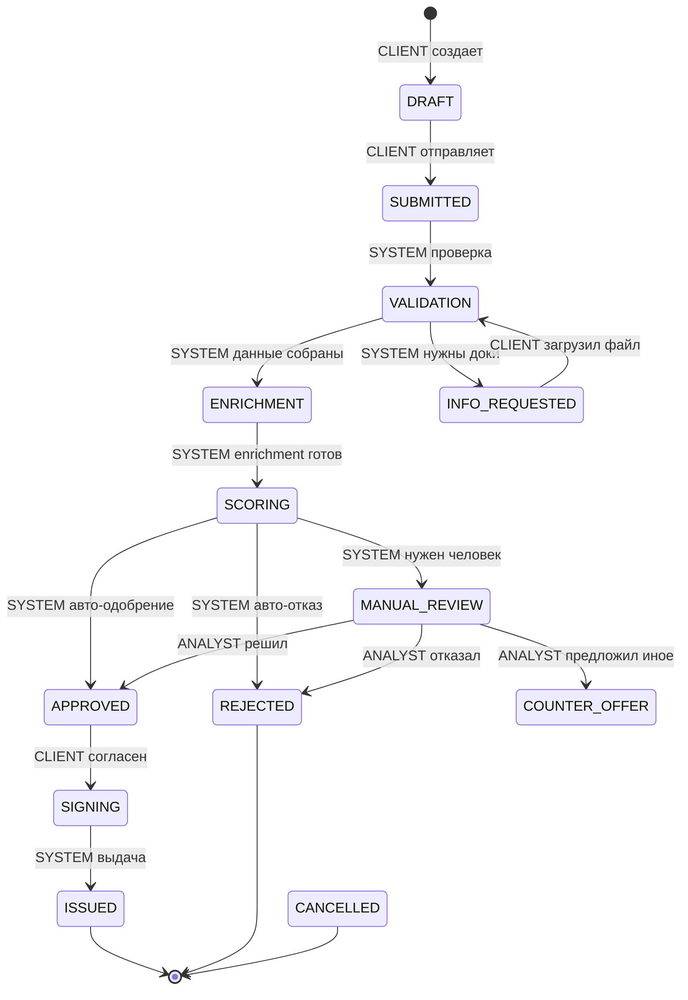

# Машина состояний заявки

## Тексты для клиента (client-view.ts)
| Статус | Что видит клиент |
|--------|------------------|
| DRAFT | Черновик сохранен. Проверьте данные и отправьте. |
| SUBMITTED | Заявка отправлена. Идет первичная проверка... |
| VALIDATION | Проверяем данные в реестрах... |
| INFO_REQUESTED | Требуется дополнительный документ. Загрузите его в личном кабинете. |
| MANUAL_REVIEW | Заявка на ручном рассмотрении у аналитика. |
| APPROVED | Поздравляем! Кредит одобрен. Перейдите к подписанию. |
| REJECTED | К сожалению, в кредите отказано. Смотрите причины в деталях. |